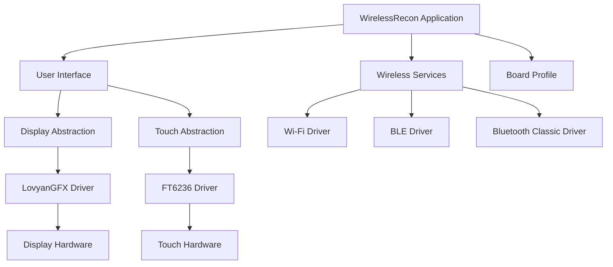
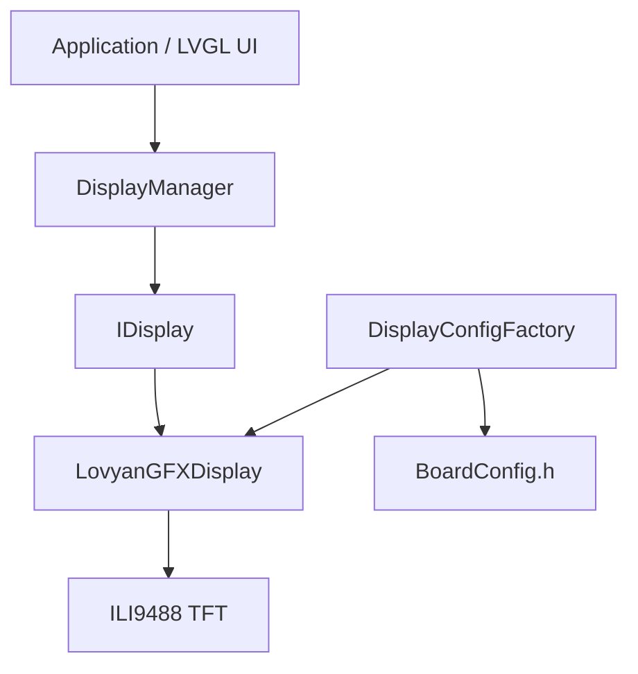
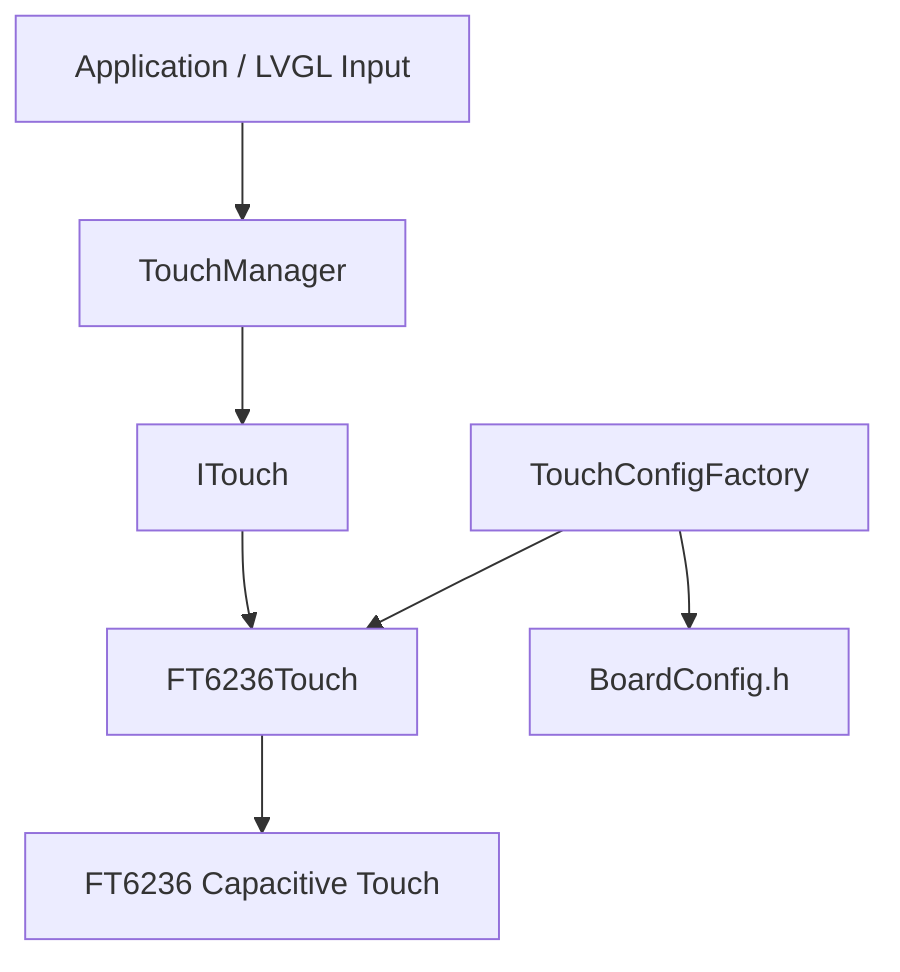
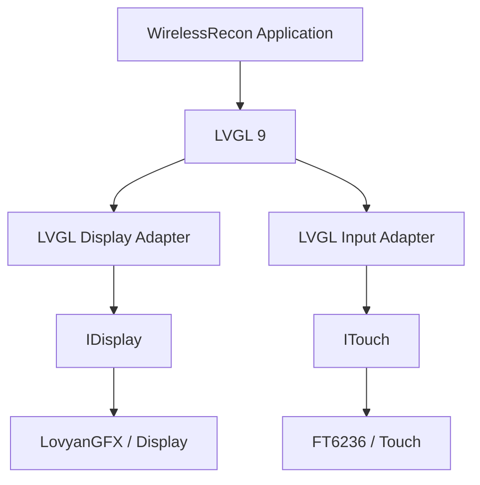

# WirelessRecon

**A modular, portable wireless reconnaissance platform built on ESP32 hardware.**

WirelessRecon is an ESP32-based wireless reconnaissance project designed to provide a portable platform for discovering and observing nearby wireless devices. The project is being refactored into a modular, hardware-independent architecture to support multiple ESP32 boards, display controllers, and touch interfaces.

The architecture separates hardware-specific drivers from application functionality through common interfaces. This makes it possible to add new boards and peripherals without rewriting the application for each hardware configuration.

> **Development status:** The original Phase 7.1 firmware is a verified, working baseline. The modular implementation has completed board profiling, display abstraction, and touch abstraction. LVGL 9 integration is the next development phase.

---

## Contents

- [Project Goals](#project-goals)
- [Features and Capabilities](#features-and-capabilities)
- [Architecture](#architecture)
- [Hardware](#hardware)
- [Software and Dependencies](#software-and-dependencies)
- [Repository Structure](#repository-structure)
- [Getting Started](#getting-started)
- [Build Instructions](#build-instructions)
- [Upload and Serial Monitoring](#upload-and-serial-monitoring)
- [Supported Build Environments](#supported-build-environments)
- [Development Roadmap](#development-roadmap)
- [Design Principles](#design-principles)
- [Responsible Use](#responsible-use)

---

## Project Goals

WirelessRecon is being developed around five primary goals:

1. **Hardware portability:** Support multiple ESP32-based boards through independent board profiles.
2. **Modular architecture:** Separate wireless functionality, display hardware, touch input, and application logic.
3. **Reusable interfaces:** Allow hardware drivers to be replaced without changing application-level code.
4. **Modern UI framework:** Use LVGL 9 to provide a consistent touchscreen interface across supported displays.
5. **Maintainability:** Use PlatformIO, structured source directories, and incremental hardware verification.

The project preserves the original Phase 7.1 implementation as a regression baseline while new functionality is developed independently.

---

## Features and Capabilities

### Existing Phase 7.1 firmware

The original firmware provides the established functional baseline:

- Wi-Fi access point discovery.
- BLE device discovery.
- Bluetooth Classic device discovery.
- Wireless device inventory and signal-strength tracking.
- RSSI history and proximity-oriented tracking.
- Touchscreen-based navigation.
- Privacy display mode for concealing device identifiers.
- Device inventory management and scan-state handling.

RSSI is a relative signal-strength measurement. It should not be interpreted as a precise physical distance measurement.

### Modular implementation

The modular implementation is progressively replacing hardware-specific dependencies with reusable components.

| Component | Status |
|---|---|
| Board profiles | Implemented |
| Hardware capability definitions | Implemented |
| Display configuration abstraction | Implemented |
| LovyanGFX display driver | Implemented |
| ILI9488 display initialization | Hardware verified |
| Touch configuration abstraction | Implemented |
| FT6236 touch driver | Hardware verified |
| Touch coordinate mapping | Verified |
| LVGL 9 integration | Planned next |
| Wireless service abstraction | Planned |
| Application UI migration | Planned |
| Regression testing | Planned |

---

## Architecture

### High-level architecture

The modular design separates the application from the hardware implementation.



### Hardware abstraction

Board-specific configuration is isolated in board profiles.

Each profile describes the capabilities and hardware characteristics of its target board, including:

- Wireless capabilities.
- Display controller and resolution.
- Touch controller and interface.
- GPIO assignments.
- SPI and I²C configuration.
- PSRAM availability.

The application and hardware managers consume these definitions rather than embedding board-specific pin assignments throughout the codebase.

### Display architecture



`IDisplay` provides a common interface for initialization, drawing, rotation, dimensions, and backlight control.

`LovyanGFXDisplay` implements that interface and handles the underlying display-controller configuration.

### Touch architecture



`ITouch` provides a consistent interface for touch initialization, state detection, coordinate reads, and rotation.

`FT6236Touch` implements the interface using I²C communication.

### LVGL integration target

The next phase introduces LVGL 9 above the existing display and touch interfaces.



This design keeps LVGL independent of individual display and touch controllers.

---

## Hardware

### Verified development board

**ThingPulse Color Kit Grande / ESP32-WROVER**

| Component | Specification |
|---|---|
| MCU | Original ESP32 |
| Module | ESP32-WROVER |
| Display controller | ILI9488 |
| Display resolution | 320 × 480 |
| Touch controller | FT6236 |
| Touch interface | I²C |
| Display interface | SPI |
| PSRAM | Supported and enabled |
| Wi-Fi | Supported |
| BLE | Supported |
| Bluetooth Classic | Supported |

### Display pin configuration

| Signal | ESP32 GPIO |
|---|---:|
| SPI SCLK | 5 |
| SPI MOSI | 18 |
| SPI MISO | 19 |
| TFT CS | 15 |
| TFT DC | 2 |
| TFT RESET | 4 |
| Backlight | 32 |

Display configuration:

- SPI mode: 0
- Write frequency: 20 MHz
- Read frequency: 16 MHz
- Panel: ILI9488
- Native resolution: 320 × 480

### Touch pin configuration

| Signal | ESP32 GPIO |
|---|---:|
| I²C SDA | 23 |
| I²C SCL | 22 |
| I²C address | `0x38` |
| I²C frequency | 400 kHz |

Touch configuration:

- Controller: FT6236
- Interface: I²C
- Resolution: 320 × 480
- Rotation: 0
- X/Y swap: Disabled
- X inversion: Disabled
- Y inversion: Disabled

### Hardware verification

The ThingPulse display and touch interfaces have been physically tested.

The display test verified:

- Display initialization.
- Black background rendering.
- White border rendering.
- Red, green, blue, and yellow color bars.
- Text rendering.

The touch test verified:

| Test location | Reported coordinates |
|---|---:|
| Top-left | (0, 0) |
| Top-right | (319, 0) |
| Bottom-left | (0, 477) |
| Bottom-right | (319, 477) |
| Center | (157, 244) |

The FT6236 successfully detected touch events, reported coordinates, and detected release events.

---

## Software and Dependencies

| Software | Version / Configuration |
|---|---|
| Build system | PlatformIO |
| Framework | Arduino |
| ESP32 platform | `espressif32@6.6.0` |
| Arduino-ESP32 | 2.0.14 |
| LovyanGFX | 1.3.0 |
| LVGL | 9.6.0 |
| C++ | PlatformIO ESP32 toolchain |

### PlatformIO libraries

The project uses the following primary dependencies:

- `lovyan03/LovyanGFX@^1.2.0`
- `lvgl/lvgl@^9.2.2`

PlatformIO resolves compatible library versions from the project configuration.

---

## Repository Structure

The modular source tree separates hardware definitions, drivers, interfaces, and build targets.

```text
WirelessRecon_Modular/
│
├── platformio.ini
│
├── include/
│   └── hardware/
│       ├── HardwareTypes.h
│       ├── BoardProfile.h
│       │
│       ├── boards/
│       │   ├── thingpulse_wrover/
│       │   │   └── BoardConfig.h
│       │   ├── esp32_32e/
│       │   │   └── BoardConfig.h
│       │   ├── esp32_s3/
│       │   │   └── BoardConfig.h
│       │   └── esp32_c3/
│       │       └── BoardConfig.h
│       │
│       ├── display/
│       │   ├── IDisplay.h
│       │   ├── DisplayConfig.h
│       │   ├── DisplayManager.h
│       │   ├── DisplayConfigFactory.h
│       │   └── drivers/
│       │       └── LovyanGFXDisplay.h
│       │
│       └── touch/
│           ├── ITouch.h
│           ├── TouchConfig.h
│           ├── TouchManager.h
│           ├── TouchConfigFactory.h
│           └── drivers/
│               └── FT6236Touch.h
│
├── src/
│   ├── core/
│   │   └── DeviceInventory.cpp
│   │
│   ├── hardware/
│   │   ├── display/
│   │   │   ├── DisplayManager.cpp
│   │   │   ├── DisplayConfigFactory.cpp
│   │   │   └── drivers/
│   │   │       └── LovyanGFXDisplay.cpp
│   │   │
│   │   └── touch/
│   │       ├── TouchManager.cpp
│   │       ├── TouchConfigFactory.cpp
│   │       └── drivers/
│   │           └── FT6236Touch.cpp
│   │
│   ├── legacy/
│   │   └── WirelessRecon_Phase7_1_Baseline.cpp
│   │
│   └── targets/
│       └── board_scaffold.cpp
│
├── lib/
├── test/
└── README.md
```

The tree illustrates the current architecture and principal files. Additional application, UI, and wireless-service directories will be introduced as those phases are implemented.

---

## Getting Started

### Prerequisites

You will need:

- A Linux, macOS, or Windows development machine.
- Git.
- Python 3.
- PlatformIO Core or the PlatformIO IDE extension.
- A supported ESP32 development board.
- A USB data cable.
- The appropriate USB serial driver for your board.

This project is currently developed and verified using Fedora Linux and PlatformIO Core.

### Clone the repository

```bash
git clone https://github.com/Coded-Alchemy/WirelessRecon.git
cd WirelessRecon
```

Replace the repository URL with the actual GitHub repository address.

### Install PlatformIO Core

If PlatformIO Core is not already installed:

```bash
python3 -m pip install --user platformio
```

Check the installation:

```bash
pio --version
```

### Resolve project dependencies

From the project root:

```bash
pio pkg install
```

Inspect the installed packages:

```bash
pio pkg list -e thingpulse_wrover_modular
```

---

## Build Instructions

### Build the modular ThingPulse target

The modular ThingPulse environment builds the new board, display, and touch abstraction layers.

```bash
pio run -e thingpulse_wrover_modular
```

A successful build should report:

```text
========================= [SUCCESS] =========================
```

### Build the legacy Phase 7.1 baseline

The original firmware has its own independent PlatformIO environment.

```bash
pio run -e thingpulse_wrover
```

This environment is intentionally isolated from the modular implementation.

**Do not merge the legacy source into the modular target or change its source filter as part of routine modular development.** The legacy environment is retained as a known-good regression baseline.

### Clean build artifacts

To clean the modular environment:

```bash
pio run -e thingpulse_wrover_modular -t clean
```

Then rebuild:

```bash
pio run -e thingpulse_wrover_modular
```

---

## Upload and Serial Monitoring

### Identify the ESP32 serial port

On Linux:

```bash
pio device list
```

You can also inspect available serial devices:

```bash
ls /dev/ttyACM*
ls /dev/ttyUSB*
```

The actual device path depends on the board and USB interface.

### Upload the modular firmware

Replace the port below with the port reported by your system.

```bash
pio run -e thingpulse_wrover_modular \
    -t upload \
    --upload-port /dev/ttyACM0
```

### Open the serial monitor

```bash
pio device monitor \
    -p /dev/ttyACM0 \
    -b 115200
```

The modular hardware diagnostics use a baud rate of 115200.

---

## Supported Build Environments

The project defines several PlatformIO environments.

| Environment | Target | Purpose |
|---|---|---|
| `thingpulse_wrover` | ESP32-WROVER | Legacy Phase 7.1 baseline |
| `thingpulse_wrover_modular` | ESP32-WROVER | Current modular development |
| `esp32_s3` | ESP32-S3 | Board scaffold |
| `esp32_c3` | ESP32-C3 | Board scaffold |
| `esp32_32e_28lcd` | ESP32-32E profile | Board scaffold |
| `esp32_32e_28lcd_test` | ESP32-32E profile | Separate hardware diagnostic |

The ThingPulse modular target is the currently verified development target. The other modular board environments are scaffolds and should not be interpreted as fully validated hardware support.

---

## Development Roadmap

Development is organized into incremental phases so that each hardware layer can be verified before the next is introduced.

| Phase | Description | Status |
|---|---|---|
| Legacy baseline | Preserve original Phase 7.1 functionality | Complete |
| Phase 1 | Modular project structure and board profiles | Complete |
| Phase 2 | Display abstraction and LovyanGFX driver | Complete |
| Phase 3 | Touch abstraction and FT6236 driver | Complete |
| Phase 4 | LVGL 9 integration | Next |
| Phase 5 | Wireless service abstraction | Planned |
| Phase 6 | Application and UI integration | Planned |
| Phase 7 | Regression and multi-board verification | Planned |

### Phase 4 — LVGL 9

The next development phase will introduce:

- LVGL initialization.
- Display buffer and flush handling.
- LVGL display adapter using `IDisplay`.
- LVGL touch input adapter using `ITouch`.
- Touch-responsive test interface.
- Memory configuration appropriate for ESP32 and PSRAM.
- Independent modular build verification.

### Phase 5 — Wireless services

Wireless functionality will be moved behind reusable service interfaces.

The goal is to separate scanning and inventory logic from board-specific hardware and UI code.

### Phase 6 — Application integration

The application layer will integrate the UI, hardware managers, device inventory, and wireless services.

### Phase 7 — Regression testing

Testing will validate:

- Existing Phase 7.1 functionality.
- Display initialization and drawing.
- Touch coordinate mapping.
- Wireless scanning behavior.
- Memory usage and stability.
- Board-specific configuration.
- Build reproducibility across supported targets.

---

## Design Principles

### Preserve working functionality

The original Phase 7.1 source remains available as a known-good baseline. New architecture is developed independently to avoid destabilizing existing functionality.

### Separate interfaces from implementations

Application code should depend on interfaces such as `IDisplay` and `ITouch`, rather than directly depending on LovyanGFX or FT6236-specific APIs.

### Keep board configuration centralized

Pin assignments, controllers, resolution, and capabilities belong in board profiles.

### Verify incrementally

Each phase should compile and undergo hardware testing before the next phase begins.

### Avoid unnecessary hardware coupling

Adding another ESP32 board should primarily require a new board profile and the appropriate driver implementations, rather than rewriting application functionality.

---

## Responsible Use

WirelessRecon is intended for authorized wireless discovery, inventory, research, and security testing.

Only use the platform on networks and devices you own or have explicit permission to assess.

Wireless discovery can expose information about nearby devices. Treat collected identifiers and other observations as potentially sensitive data. Do not use the platform to disrupt networks, intercept private communications, or access devices without authorization.

---

## Project Status

**Current development target:** ThingPulse Color Kit Grande / ESP32-WROVER

**Current modular milestone:** Display and touch hardware abstraction verified

**Next milestone:** LVGL 9 display and touch integration

The modular architecture is under active development. Hardware support and feature completeness vary by target. Refer to the development roadmap and build environment descriptions before assuming a board or feature is fully supported.

---

## License

License information has not yet been specified. Until a license is added to the repository, all rights remain with the copyright holder.