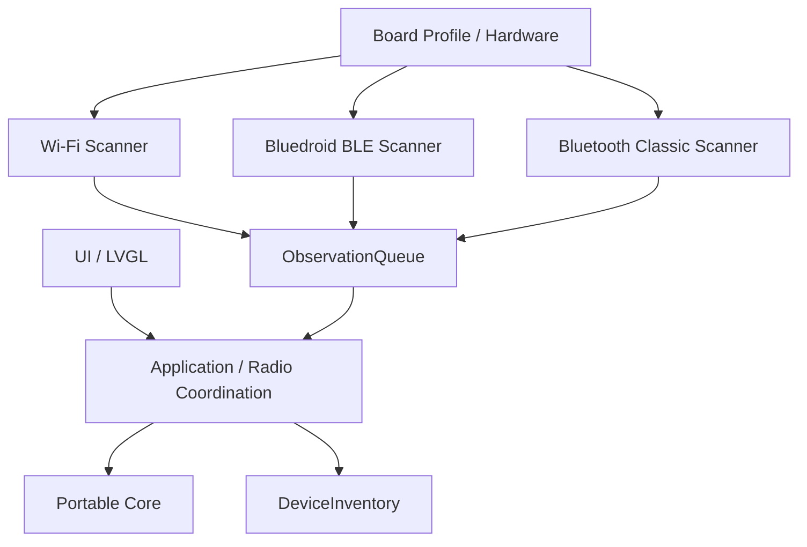

# WirelessRecon Architecture

## System architecture

WirelessRecon separates portable application logic from board-specific hardware.

## Dependency direction

`UI -> Application services -> Core models/services <- Radio adapters`

The core must not include Arduino, ESP-IDF, LovyanGFX, LVGL, or board pin headers. Hardware and radio adapters translate platform-native events into `wirelessrecon::core::Device` observations.

## Core responsibilities

| Component | Responsibility |
|---|---|
| `Device` | Common device identity, signal, and lifecycle data |
| `DeviceInventory` | Device identity, sightings, visibility, and historical records |
| `ObservationQueue` | Thread-safe handoff from asynchronous radio callbacks |
| `IRadioScanner` | Portable scanner lifecycle contract |
| `WirelessCoordinator` | Scanner registration, scan requests, queue draining, and inventory lifecycle |

The coordinator does not implement radio hardware or presentation logic.

## Identity

A device is identified by `(RadioType, address)`. Addresses are not globally unique across radio families, so the radio type is part of the key.

Wi-Fi-specific fields remain in `WifiMetadata`. Common fields cover identity, signal, sightings, and lifecycle.

## Scan lifecycle

1. `beginScan(radio)` marks existing devices of that radio unseen for the new scan.
2. The scanner submits observations to `ObservationQueue`.
3. `WirelessCoordinator::process()` drains the queue into `DeviceInventory`.
4. `completeScan(radio)` sets visibility from the observations received during the scan and increments the inventory generation.
5. A terminal scanner is reset and can be used again.

A cancelled scan preserves historical observations but does not mark partial results as a successful scan.

## Radio implementation status

| Radio | Adapter | Stack | Status |
|---|---|---|---|
| Wi-Fi | `WifiScanner` | Arduino Wi-Fi | Implemented and hardware validated |
| BLE | `BleScanner` | Bluedroid on original ESP32 | Implementation added; hardware validation pending |
| Bluetooth Classic | Planned | Bluedroid on original ESP32 | Planned |

## Bluetooth stack selection

The original ESP32 supports BLE and Bluetooth Classic through the dual-mode Bluedroid stack.

- ThingPulse ESP32-WROVER: Bluedroid for BLE and Classic.
- ESP32-32E: Bluedroid for BLE and Classic.
- ESP32-S3: BLE-only NimBLE implementation planned.
- ESP32-C3: BLE-only NimBLE implementation planned.

The portable scanner interface and coordinator do not depend on the selected Bluetooth host stack.

## Concurrency

`DeviceInventory` is deliberately not internally synchronized. The application layer serializes inventory updates through `WirelessCoordinator`.

Radio callbacks must submit observations through `ObservationQueue`. They must not access `DeviceInventory` directly.

The queue is bounded. When full, it rejects new observations and increments its dropped-observation counter.

## Bluetooth lifecycle and coexistence

The original ESP32 shares its Bluetooth controller between BLE and Bluetooth Classic.

Bluedroid is initialized lazily when the first BLE scan starts. It remains initialized after a scan finishes. Scanner reset must not deinitialize the Bluetooth host or controller.

A BLE stop request is asynchronous. The scanner remains in `Stopping` until the Bluedroid scan-completion callback confirms that advertisement callbacks have finished.

The first implementation uses sequential Wi-Fi and BLE scans. Concurrent scanning can be evaluated separately after sequential operation is hardware validated.

## Memory

Device inventory capacity is fixed at 150 entries to match the current maximum of 50 records per radio.

The model uses `std::string`. Before expanding capacity or adding long histories, measure heap fragmentation on non-PSRAM boards. RSSI history remains a separate bounded service in a later phase.

## ESP32-32E N4 display-board profile

The board photo shows an ESP32-32E N4 module and PCB silkscreen identifying a 2.8-inch 240x320 resistive-touch LCD.

The profile declares the original ESP32 radio set (Wi-Fi, BLE, and Bluetooth Classic), no PSRAM, and the display geometry/touch type. It does not declare an LCD driver, touch-controller driver, or pin map: those require the board's schematic, controller markings, or a controlled hardware identification test.

Do not reuse the ThingPulse ILI9488/FT6236 wiring for this board without verification.
