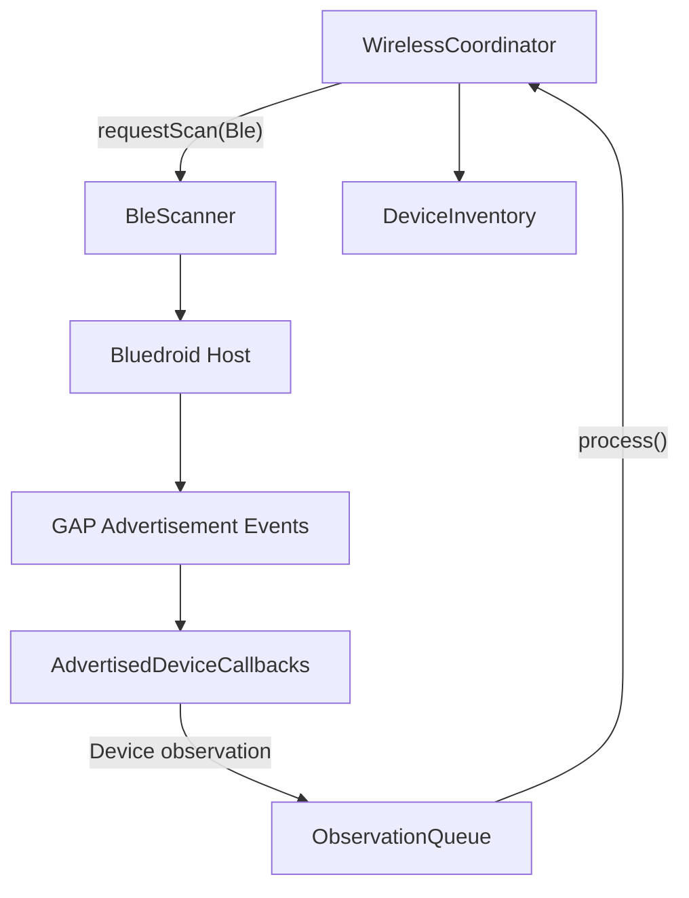
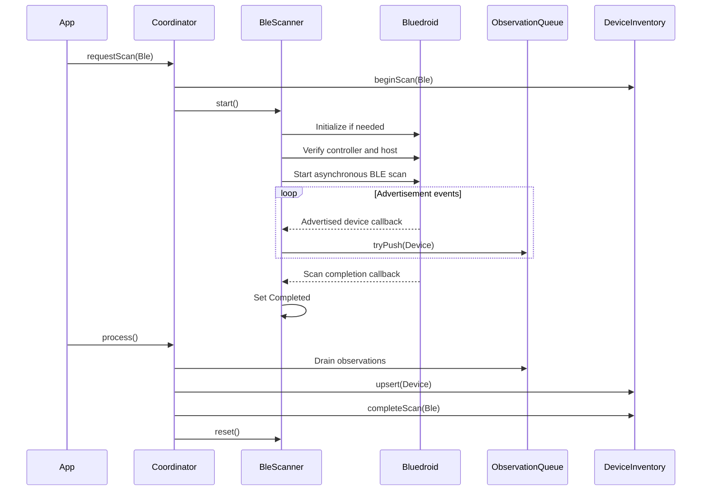

# Bluetooth Architecture

## Stack selection

Bluetooth host selection is board-specific.

| Board | Bluetooth host | BLE | Bluetooth Classic |
|---|---|---|---|
| Original ESP32-WROVER | Bluedroid | Yes | Yes |
| ESP32-32E | Bluedroid | Yes | Yes |
| ESP32-S3 | NimBLE planned | Yes | No |
| ESP32-C3 | NimBLE planned | Yes | No |

NimBLE is appropriate for BLE-only targets. It must not replace Bluedroid on the original ESP32 targets where Bluetooth Classic support is required.

## Original ESP32 BLE data flow

## BLE scan lifecycle

## Device observation mapping

| BLE information | Device field |
|---|---|
| Bluetooth address | `address` |
| Advertised name | `name` |
| Advertisement RSSI | `rssi` |
| Observation time | `firstSeenMs`, `lastSeenMs` |
| Radio type | `RadioType::Ble` |

The first implementation suppresses duplicate advertisements to limit queue pressure. RSSI history and repeated-advertisement tracking are planned separately.

## Initialization and lifetime

Bluedroid is initialized lazily on the first BLE scan.

The scanner verifies both:

- Bluetooth controller status is enabled.
- Bluedroid host status is enabled.

The stack remains initialized after the scan. `reset()` resets the scanner lifecycle only; it does not deinitialize Bluetooth.

This is intentional because BLE and Bluetooth Classic share the original ESP32 Bluetooth controller and host stack.

## Cancellation

Calling `stop()` requests scan cancellation. The scanner enters `Stopping`.

It does not become `Idle` until the Bluedroid scan-completion callback arrives. That callback runs after advertisement callbacks for the scan have completed.

This prevents a new scan from starting while the previous scan can still submit observations.

## Coexistence policy

The first implementation uses sequential scans:

1. Complete Wi-Fi scan.
2. Complete BLE scan.
3. Allow later application scheduling to select the next scan.

The coordinator also prevents BLE and Bluetooth Classic scans from overlapping when the board reports a shared Bluetooth controller.

Concurrent Wi-Fi and BLE scanning is a future, separately validated behavior.

## Validation status

The Bluedroid adapter is implemented for the original ESP32 target. Hardware validation is pending.

The first hardware test should confirm:

- Controller and host initialization.
- Advertisement callback delivery.
- Observation queue delivery.
- Inventory updates.
- Successful scan completion and reset.
- A subsequent Wi-Fi scan after BLE completion.
