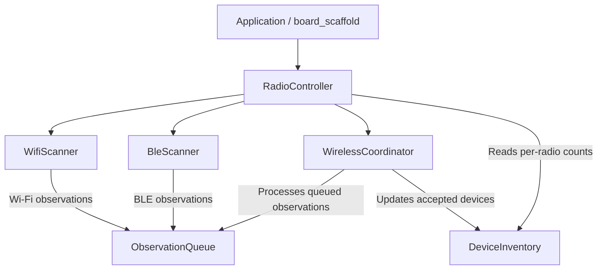
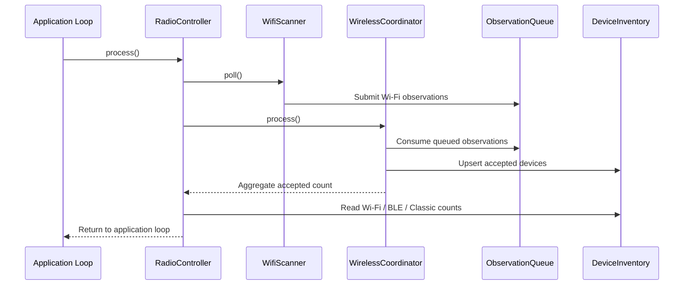

# Phase 6.1B — Radio Controller Extraction

## Status

**Implementation status:** Validated on `thingpulse_wrover_modular`  
**Build system:** PlatformIO  
**Framework:** Arduino / ESP32  
**UI:** LVGL 9  
**Display:** LovyanGFX

This phase extracts radio registration and runtime processing from `board_scaffold.cpp` into a dedicated `RadioController`.

The extraction preserves the existing scanner implementations, coordinator ownership, observation queue, and inventory lifecycle.

## 1. Objectives

The RadioController extraction is intended to:

- Centralize radio scanner registration.
- Centralize the normal runtime radio-processing sequence.
- Keep radio-specific inventory reporting accurate.
- Keep scanner implementations independent of application orchestration.
- Reduce the responsibilities of `board_scaffold.cpp`.
- Preserve existing diagnostic and startup behavior.

This is an orchestration extraction, not a replacement of the radio scanners or `WirelessCoordinator`.

## 2. Component Responsibilities

| Component | Responsibility |
|---|---|
| `RadioController` | Registers scanners and coordinates normal radio processing |
| `WirelessCoordinator` | Owns scan orchestration, scanner state, and observation processing |
| `WifiScanner` | Performs Wi-Fi discovery and submits observations |
| `BleScanner` | Performs BLE discovery and submits observations |
| `ObservationQueue` | Transfers scanner observations to the application processing path |
| `DeviceInventory` | Maintains the authoritative device inventory |

### Ownership boundaries

`RadioController` holds non-owning references to the coordinator, inventory, and scanner instances.

It does not allocate or delete these services.

`WirelessCoordinator` remains responsible for scanner registration state and scan lifecycle coordination. `DeviceInventory` remains the authoritative source for device counts and records.

Scanner callbacks must not directly modify the inventory or call into the coordinator. They submit observations through the observation queue.

## 3. Architecture

## 4. Runtime Processing Sequence

The normal runtime processing path is:

1. The application invokes `RadioController::process()`.
2. The controller polls the Wi-Fi scanner.
3. The controller invokes `WirelessCoordinator::process()`.
4. The coordinator processes queued observations.
5. Accepted observations update `DeviceInventory`.
6. The controller reads inventory counts by radio type.
7. The controller reports accepted observations and inventory changes.

## 5. Accepted Observation Counts

`WirelessCoordinator::process()` returns an aggregate accepted-observation count across registered radios.

That value must not be labeled as a Wi-Fi-only count.

The controller reports the aggregate separately from the per-radio inventory counts:

- Wi-Fi
- BLE
- Bluetooth Classic

These counts represent the current inventory totals, not necessarily the number of observations accepted during the most recent processing call.

This distinction prevents BLE observations from being incorrectly reported as Wi-Fi activity.

## 6. Startup Behavior

During normal startup:

1. Core memory services are initialized.
2. The display and touch services are initialized.
3. LVGL is initialized.
4. The radio controller registers the available scanners.
5. Wi-Fi scanning starts through the existing coordinator path.
6. BLE remains subject to its existing lazy initialization and runtime activation behavior.

The controller's registration-time message that Bluedroid remains uninitialized describes the state at registration. It does not mean BLE discovery cannot subsequently start.

The observed runtime logs confirm BLE observations are accepted after startup.

## 7. Scanner Lifecycle and Boundaries

The controller does not replace the scanner lifecycle defined by `IRadioScanner`.

The existing lifecycle states remain:

- `Idle`
- `Running`
- `Stopping`
- `Completed`
- `Failed`

The coordinator remains responsible for scan orchestration and lifecycle coordination.

The controller must not introduce a second authoritative scanner state or duplicate inventory.

Diagnostic-mode sequencing remains separate from the normal radio-processing path. In particular, existing Wi-Fi and BLE diagnostic behavior must be preserved when making future changes.

## 8. Threading and Memory Constraints

The following architecture constraints remain in effect:

- Scanner callbacks submit observations to `ObservationQueue`.
- `ObservationQueue` remains allocated in internal RAM.
- `DeviceInventory` is allocated in PSRAM.
- `DeviceInventory` remains the authoritative inventory.
- LVGL is only serviced or modified from the application/UI task.
- Radio callbacks must not directly manipulate LVGL objects.
- `RadioController` must not take ownership of services supplied by the application.

Internal DRAM usage must be monitored as additional radio and UI functionality is introduced. PSRAM availability does not eliminate internal RAM constraints for queues, task stacks, and other runtime services.

## 9. Validation Results

The `thingpulse_wrover_modular` environment successfully booted after the RadioController integration.

Observed results:

| Validation | Result |
|---|---|
| ESP32 boot | Pass |
| PSRAM detection | Pass |
| DeviceInventory PSRAM allocation | Pass |
| Display initialization | Pass |
| Touch initialization | Pass |
| LVGL dashboard initialization | Pass |
| Wi-Fi scanner registration | Pass |
| BLE scanner registration | Pass |
| Wi-Fi discovery | Pass |
| BLE observation processing | Pass |
| Per-radio inventory reporting | Pass |

### Observed inventory output

The device reported Wi-Fi and BLE counts separately. During the observed session:

- Wi-Fi inventory reached 51 devices.
- BLE inventory progressed from 3 to 11 devices.
- Bluetooth Classic remained at 0.

These are observed test-session values, not guaranteed discovery totals.

### Memory observations

The observed boot logs reported approximately:

| Measurement | Observed value |
|---|---:|
| Free internal DRAM before radio initialization | 145,748 bytes |
| Free internal DRAM after radio initialization | 99,072 bytes |
| Minimum-ever free internal DRAM after radio initialization | 96,736 bytes |
| Largest free internal block after radio initialization | 94,196 bytes |
| Free PSRAM after radio initialization | Approximately 4.15 MB |

These measurements are a baseline from the observed test run. They should be rechecked after subsequent extractions and feature additions.

## 10. Regression Requirements

Future changes to this component must preserve:

- Existing scanner implementations and their callbacks.
- Coordinator ownership of scan orchestration.
- Observation queue processing.
- Inventory ownership and per-radio counts.
- Lazy BLE initialization behavior.
- Diagnostic-mode sequencing.
- Existing board-specific scanner availability.
- The `thingpulse_wrover_modular` regression build.

Do not move scanner lifecycle ownership into `RadioController` or create a second inventory.

## 11. Next Extraction

The next planned modularization step is **core memory services**.

That work should isolate:

- Observation queue construction.
- PSRAM allocation of `DeviceInventory`.
- Placement construction and destruction.
- Coordinator construction and dependency wiring.
- Allocation-failure cleanup.

The extraction must preserve the current allocation strategy and initialization order. It must not change inventory capacity, queue behavior, or scanner lifecycle.

## 12. Related Documentation

- `ARCHITECTURE.md`
- `RADIO_LIFECYCLE.md`
- `WIFI_ARCHITECTURE.md`
- `BLUETOOTH_ARCHITECTURE.md`
- `PLATFORMIO_CONFIGURATION.md`
- `UI_RESPONSIVE_ARCHITECTURE.md`
