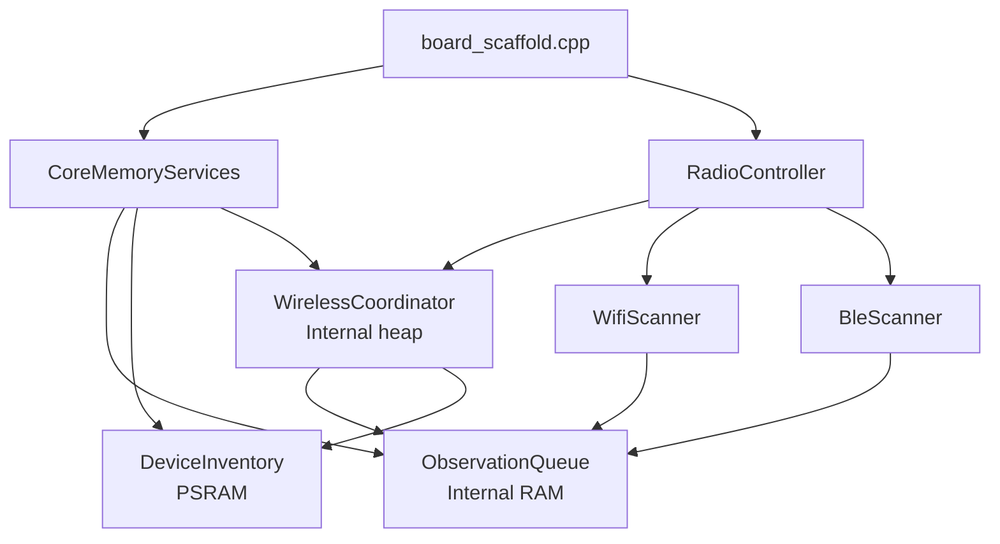
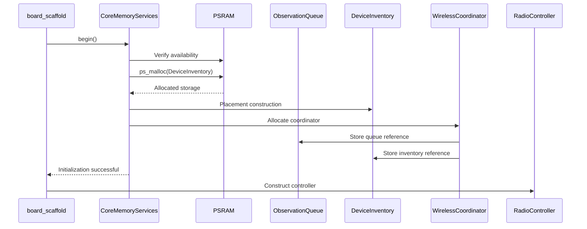

# Phase 6.1C — Core Memory Services Extraction

## Status

**Implementation:** Extracted; pending build and hardware validation  
**Target:** `thingpulse_wrover_modular`

## 1. Objective

Extract core memory allocation and service construction from `board_scaffold.cpp` into `CoreMemoryServices`.

This phase is intended to improve separation of responsibilities without changing the existing memory strategy, scanner lifecycle, or application initialization order.

## 2. Responsibilities

| Component | Responsibility |
|---|---|
| CoreMemoryServices | Owns ObservationQueue and manages DeviceInventory and WirelessCoordinator lifetimes |
| ObservationQueue | Transfers scanner observations to the coordinator |
| DeviceInventory | Maintains the authoritative device inventory |
| WirelessCoordinator | Owns scan orchestration and scanner lifecycle coordination |
| RadioController | Registers scanners and coordinates normal radio processing |
| board_scaffold.cpp | Coordinates hardware initialization and application startup |

## 3. Memory Allocation Strategy

### ObservationQueue

ObservationQueue is a member of CoreMemoryServices.

It continues to use internal RAM for its queue and synchronization resources.

### DeviceInventory

DeviceInventory continues to use external PSRAM.

Allocation sequence:

1. Verify PSRAM availability.
2. Allocate storage using `ps_malloc`.
3. Construct DeviceInventory using placement new.
4. Retain the object pointer for application services.
5. Explicitly invoke the destructor before releasing the allocation.

### WirelessCoordinator

WirelessCoordinator continues to use normal heap allocation through `new (std::nothrow)`.

It receives references to:

- DeviceInventory
- ObservationQueue
- RadioCapabilities

The coordinator is destroyed before the inventory because it holds references to the inventory and queue.

## 4. Architecture

## 5. Initialization Sequence

## 6. Ownership and Cleanup

CoreMemoryServices owns:

- ObservationQueue
- DeviceInventory allocation
- WirelessCoordinator allocation

Other application components receive non-owning references or pointers.

Cleanup order:

1. Destroy WirelessCoordinator.
2. Destroy DeviceInventory.
3. Release the PSRAM allocation.
4. Keep ObservationQueue alive until CoreMemoryServices itself is destroyed.

The class is non-copyable to prevent accidental duplication of ownership.

## 7. Failure Handling

Initialization fails if:

- PSRAM is unavailable.
- DeviceInventory allocation fails.
- WirelessCoordinator allocation fails.

Partial initialization is cleaned up before returning failure.

In the modular build, RadioController allocation remains in the application scaffold. If that allocation fails, CoreMemoryServices is explicitly shut down.

## 8. Regression Requirements

The extraction must preserve:

- Existing inventory capacity.
- Existing PSRAM allocation strategy.
- ObservationQueue internal RAM allocation.
- RadioCapabilities configuration.
- Scanner callback behavior.
- Coordinator scan lifecycle.
- Diagnostic initialization sequence.
- LVGL application context wiring.
- Existing Wi-Fi and BLE behavior.

No additional queue, inventory, or coordinator instance should be introduced.

## 9. Validation Checklist

- [ ] `thingpulse_wrover_modular` compiles.
- [ ] PSRAM detection succeeds.
- [ ] DeviceInventory is allocated in PSRAM.
- [ ] WirelessCoordinator initializes successfully.
- [ ] RadioController initializes successfully.
- [ ] Display and touch initialize.
- [ ] LVGL dashboard initializes.
- [ ] Wi-Fi discovery works.
- [ ] BLE observations are accepted.
- [ ] Per-radio inventory counts remain correct.
- [ ] MemoryDiagnostics reports expected snapshots.
- [ ] No regression in diagnostic-mode startup.

## 10. Related Documentation

- `ARCHITECTURE.md`
- `RADIO_LIFECYCLE.md`
- `BLUETOOTH_ARCHITECTURE.md`
- `WIFI_ARCHITECTURE.md`
- `PLATFORMIO_CONFIGURATION.md`
- `PHASE6_1A_DASHBOARD.md`
- `PHASE6_1B_RADIO_CONTROLLER.md`
