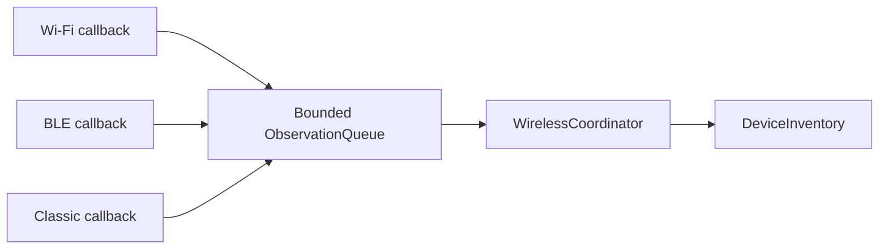
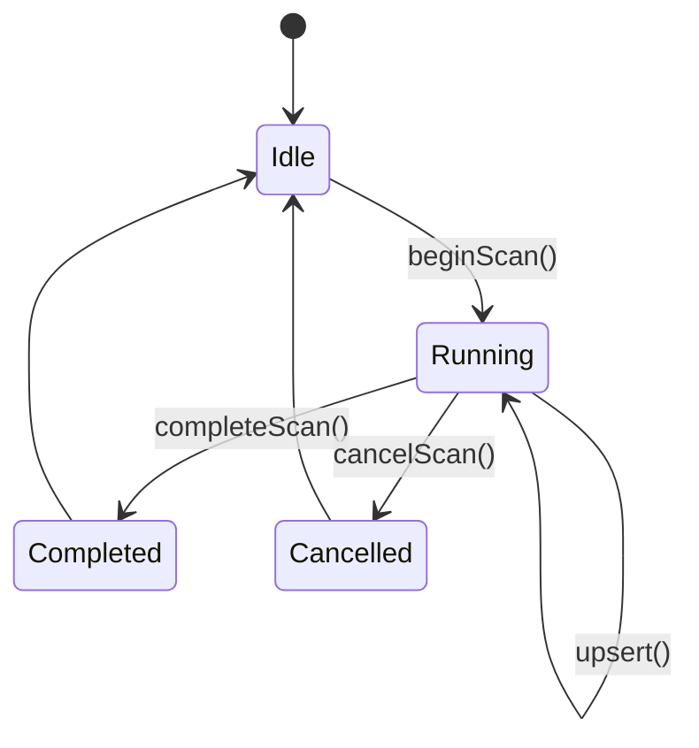

# Radio Lifecycle and Observation Processing

## Responsibilities

| Component | Owns |
|---|---|
| Radio scanner | Hardware scan and platform callbacks |
| ObservationQueue | Thread-safe observation handoff |
| WirelessCoordinator | Scan lifecycle and queue processing |
| DeviceInventory | Device identity, history, and visibility |
| UI | Presentation and user interaction |

## Observation queue

The queue has a fixed capacity of 64 observations.

It is protected by a mutex and uses FIFO ordering. If full, it rejects the newest observation and increments its dropped-observation counter. Existing queued observations are not overwritten.

## Inventory scan lifecycle

A completed scan updates visibility for the selected radio. A cancelled scan preserves historical records but does not commit partial results as a successful scan.

## Coordinator processing

The coordinator drains queued observations before resolving terminal scanner states. This ensures that final observations are included in a completed scan.

All coordinator and inventory operations run on the application task. Radio callbacks communicate through the queue only.

## Bluetooth cancellation

Bluetooth cancellation is asynchronous. The scanner remains in `Stopping` until its completion callback confirms that no more observations from the cancelled scan can be submitted.

The coordinator must not treat a stop request as proof that hardware callbacks have stopped.

## Development rule

Do not let a hardware callback update `DeviceInventory` directly. Add observations to `ObservationQueue` and let `WirelessCoordinator::process()` perform inventory updates.
