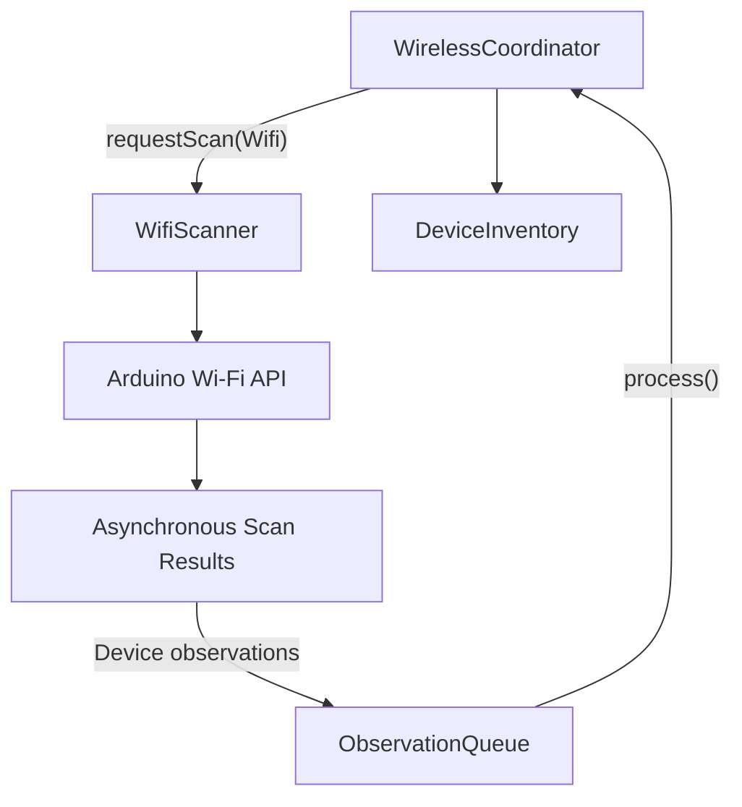

# Wi-Fi Scanner Architecture

## Implementation

The ESP32 Arduino Wi-Fi adapter is `WifiScanner`.

It performs asynchronous station-mode scans and converts discovered access points into portable `Device` observations.

## Data flow

## Scan lifecycle

```mermaid
sequenceDiagram
    participant App
    participant Coordinator
    participant Scanner as WifiScanner
    participant WiFi as Arduino Wi-Fi
    participant Queue as ObservationQueue
    participant Inventory as DeviceInventory

    App->>Coordinator: requestScan(Wifi)
    Coordinator->>Inventory: beginScan(Wifi)
    Coordinator->>Scanner: start()
    Scanner->>WiFi: Configure station mode
    Scanner->>WiFi: Start asynchronous scan
    WiFi-->>Scanner: Scan running

    loop Application processing
        App->>Scanner: poll()
        Scanner->>WiFi: scanComplete()
    end

    WiFi-->>Scanner: Scan results available
    Scanner->>WiFi: Read network information
    loop Each discovered access point
        Scanner->>Queue: tryPush(Device)
    end

    App->>Coordinator: process()
    Coordinator->>Queue: Drain observations
    Coordinator->>Inventory: upsert(Device)
    Coordinator->>Inventory: completeScan(Wifi)
    Coordinator->>Scanner: reset()
```

## Observation mapping

| Wi-Fi information | Device field |
|---|---|
| BSSID | `address` |
| SSID | `name` and `wifi.ssid` |
| RSSI | `rssi` |
| Channel | `wifi.channel` |
| Encryption type | `wifi.encryption` |
| Hidden network | `wifi.hidden` |
| Observation time | `firstSeenMs`, `lastSeenMs` |

BSSID is used as the stable device identity. SSID is not an identity because multiple access points can advertise the same SSID.

## Scan configuration

The current adapter:

- Uses station mode.
- Includes hidden networks.
- Performs an asynchronous scan.
- Uses a 600 ms maximum per channel.
- Deletes scan results after collection.
- Reports observations queued and rejected.

## Validation

Wi-Fi scanning has been validated on the ThingPulse ESP32-WROVER.

A diagnostic run discovered 39 access points, queued all 39 observations, and reported zero rejected observations.

## Future work

- Channel utilization analysis.
- Vendor identification from BSSID prefixes.
- Security classification.
- Rogue access-point indicators.
- RSSI history and proximity estimates.
